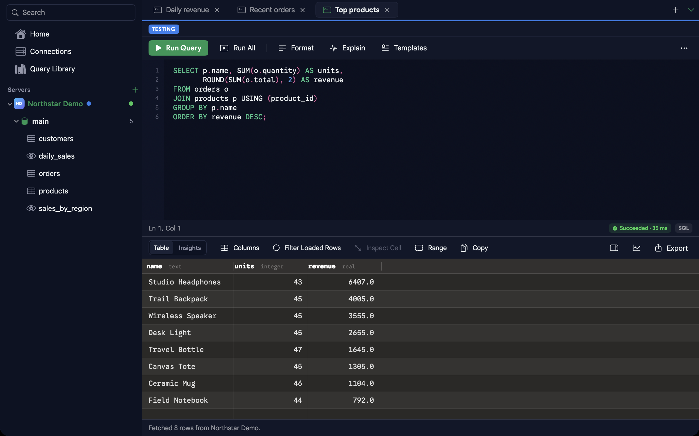

# Portbase

[English](README.md) · [简体中文](README.zh-CN.md) · [Español](README.es.md) · [日本語](README.ja.md)


Portbase es un cliente de bases de datos nativo para iPhone, iPad y Mac. Permite explorar bases de datos, ejecutar consultas, inspeccionar y editar resultados y guardar gráficos en un mismo espacio de trabajo.
El proyecto se llamaba PortSQL; el proyecto de Xcode y el destino de iOS conservan ese nombre.

[Descargar en el App Store](https://apps.apple.com/app/id6762447018) ·
[Flujo de compilación](https://github.com/iebb/portbase/actions/workflows/app-store-connect.yml) ·
[Capturas de pantalla](Docs/screenshots/README.md) ·
[Código fuente](https://github.com/iebb/portbase)

## Bases de datos compatibles

| Base de datos | Herramientas |
| --- | --- |
| MySQL y MariaDB | Consolas SQL, exploración del esquema, edición de filas identificables, transacciones, importación y exportación |
| PostgreSQL | Consolas SQL, exploración del esquema, edición de filas identificables, transacciones, importación y exportación |
| SQLite | Archivos locales, exploración del esquema, edición de filas identificables, importación y exportación |
| MongoDB | Comandos JSON, exploración y edición de documentos, canalizaciones de agregación, inspección de índices, importación y exportación |
| Redis | Exploración de claves con SCAN, inspección de valores según su tipo, comandos y cambios de caducidad con confirmación |
| ClickHouse | Consultas SQL por HTTP/HTTPS, exploración de bases de datos y tablas, resultados y gráficos |
| Elasticsearch | Solicitudes JSON, mapeos de índices, resultados de búsqueda, agregaciones y escritura de documentos con confirmación |

Las funciones varían según el motor. Las transacciones de consola están disponibles para MySQL, MariaDB y PostgreSQL.
Redis utiliza un único servidor; no se ha implementado el descubrimiento de Cluster ni de Sentinel.
ClickHouse y Elasticsearch no ofrecen el editor de filas relacional. Consulta [compatibilidad y límites](Docs/portbase.md) (en inglés).

## Espacio de trabajo

- Varias consolas de consultas con recuperación de borradores, consultas guardadas e historial de ejecución con búsqueda.
- Autocompletado SQL, formato, parámetros, Explain, navegación por líneas y atajos de teclado.
- Tablas con filtros y ordenación; columnas de resultados que se pueden redimensionar, fijar u ocultar.
- Inspección del valor completo de las celdas, distinción entre NULL y texto vacío y envío conjunto de cambios en filas identificables.
- Ejecución manual de gráficos guardados y exportación de resultados cargados a CSV o JSON. Los motores indicados también admiten importación y exportación de consultas completas.
- Etiquetas de entorno para las conexiones y perfiles de solo lectura para consultar datos de producción.



La interfaz está disponible en inglés, alemán, español, francés, japonés, coreano, portugués de Brasil, ruso, chino simplificado y chino tradicional.

## Conexiones y seguridad de los datos

De forma predeterminada, se exige TLS con autoridades de certificación del sistema. Los perfiles también permiten CA privadas con verificación del nombre del servidor, TLS preferido y un modo explícito sin cifrar con una advertencia permanente.
Una CA no reconocida solo se guarda tras la confirmación del usuario. TLS preferido solo permite una conexión sin TLS cuando un protocolo compatible informa expresamente de que TLS no está disponible.

Los túneles SSH fijan la clave del servidor mediante su huella SHA-256 en el primer uso y rechazan los cambios de clave.
Las contraseñas, las claves y frases de contraseña SSH y los certificados CA privados permanecen en el Llavero del dispositivo. Los archivos JSON de conexiones y los datos de iCloud ocultan esos secretos.
Los archivos SQLite locales permanecen en el dispositivo.

La exploración, los gráficos y Explain usan políticas de ejecución de solo lectura. Las escrituras requieren comprobaciones específicas del motor y confirmación; la edición de filas relacionales requiere una fila de origen identificable.
Las consultas tienen un tiempo límite predeterminado de 30 segundos y los resultados en memoria se limitan a 10.000 filas, con una indicación explícita cuando se recortan.

## Compilar desde el código fuente

Se necesita macOS con Xcode 27 o posterior y compatibilidad con Swift 6. La aplicación de iOS requiere iOS 18 o posterior y la aplicación nativa de Mac requiere macOS 15 o posterior. No se utiliza Mac Catalyst.

```sh
git clone https://github.com/iebb/portbase.git
cd portbase
open PortSQL.xcodeproj
```

Selecciona `PortSQL` para iPhone/iPad o `PortbaseMac` para Mac. Las compilaciones para el simulador no necesitan credenciales de distribución.
Para un dispositivo físico, configura tu propio equipo de firma y las capacidades en una copia local. La firma del App Store y los identificadores de iCloud transferidos que figuran en el repositorio pertenecen a la aplicación publicada.

Las dependencias se resuelven con Swift Package Manager. Conserva el archivo de bloqueo y el paquete `Packages/mysql-nio`: contiene correcciones de transporte y de valores tipados que deben mantenerse al actualizar dependencias.

`project.yml` es la fuente de configuración de XcodeGen. Antes de regenerar el proyecto, compara la firma y los permisos con el proyecto guardado y sigue [AGENTS.md](AGENTS.md). Las compilaciones habituales pueden usar directamente el proyecto del repositorio.

## Pruebas

Elige un simulador de iPhone instalado para ejecutar las pruebas de iOS:

```sh
xcodebuild test \
  -project PortSQL.xcodeproj \
  -scheme PortSQL \
  -destination 'platform=iOS Simulator,name=iPhone 17 Pro' \
  CODE_SIGNING_ALLOWED=NO

ruby -Itests/ci -e 'Dir["tests/ci/*_test.rb"].sort.each { |file| require File.expand_path(file) }'
sh scripts/validate-release-inputs.sh
```

Las pruebas de integración con bases de datos externas requieren sus servicios de prueba; si no están disponibles, la suite del simulador omite esas comprobaciones.
La suite de MySQL necesita una base de datos desechable. Los valores predeterminados son `test_database`, usuario `test_username` y contraseña `test_password`:

```sh
cd Packages/mysql-nio
MYSQL_HOSTNAME=127.0.0.1 MYSQL_PORT=3306 swift test
```

Puedes cambiar `MYSQL_DATABASE`, `MYSQL_USERNAME` y `MYSQL_PASSWORD`. Utiliza una base de datos desechable: las pruebas crean y modifican datos.

## Compilaciones y App Store Connect

GitHub Actions compila el commit exacto enviado a `master`, o una ejecución manual de `master`, para iOS y macOS nativo.
Utiliza los esquemas `PortSQLCI` y `PortbaseMacCI`, la configuración `Release-CI`, las credenciales de firma existentes en los secretos del repositorio y el aprovisionamiento automático. Xcode Cloud está retirado.

El flujo elige una versión comercial abierta y un número de compilación sin usar en App Store Connect, crea y sube una compilación apta para el App Store y verifica su distribución interna por TestFlight. Después solicita la revisión beta externa.
Una revisión pendiente, otra compilación en revisión o los límites de solicitudes de revisión no bloquean las subidas posteriores ni las pruebas internas. El envío de la versión pública a revisión del App Store es un paso independiente.

Consulta la [configuración de publicación y los secretos necesarios](Docs/app-store-connect.md) (en inglés). Los productos de compilación, credenciales, vistas previas locales y archivos temporales se excluyen de Git.

## Estructura del código

| Ruta | Contenido |
| --- | --- |
| `PortSQL/` | Modelos compartidos, servicios de bases de datos, vistas SwiftUI y catálogos de traducción |
| `PortbaseMac/` | Espacio de trabajo nativo de Mac, editor, tabla y punto de entrada |
| `PortSQLTests/` | Pruebas de la aplicación y sus servicios |
| `Packages/mysql-nio/` | Controlador MySQL mantenido en el repositorio y pruebas de regresión |
| `scripts/`, `tests/ci/` | Herramientas de publicación y pruebas de automatización |
| `Docs/` | Notas del producto, detalles del espacio de trabajo y documentación de publicación |

Los documentos de publicaciones anteriores reflejan el estado en el momento de cada envío. Consulta App Store Connect para conocer el estado actual de revisión y distribución.

## Licencia

El código original de Portbase se distribuye bajo la [licencia BSD de 3 cláusulas](LICENSE).
El [controlador MySQL](Packages/mysql-nio/LICENSE) incluido y las
[fuentes](PortSQL/Fonts/OFL.txt) conservan sus propias licencias.
