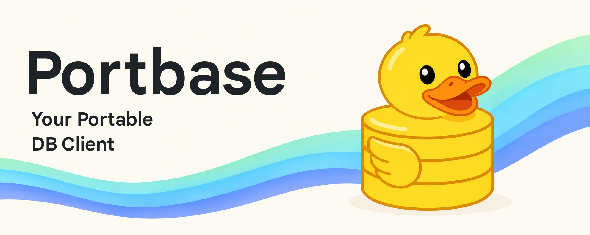

# Portbase

[English](README.md) · [简体中文](README.zh-CN.md) · [Español](README.es.md) · [日本語](README.ja.md)



Portbase 是适用于 iPhone、iPad 和 Mac 的原生数据库客户端，可在同一个工作区中浏览数据库、运行查询、查看和编辑结果，以及保存图表。
项目原名为 PortSQL；Xcode 工程和 iOS 构建目标仍沿用该名称。

[从 App Store 下载](https://apps.apple.com/app/id6762447018) ·
[构建工作流](https://github.com/iebb/portbase/actions/workflows/app-store-connect.yml) ·
[截图集](ReviewScreenshots/2.0.0/README.md) ·
[源代码](https://github.com/iebb/portbase)

## 支持的数据库

| 数据库 | 功能 |
| --- | --- |
| MySQL / MariaDB | SQL 控制台、结构浏览、具有唯一标识的行编辑、事务、导入和导出 |
| PostgreSQL | SQL 控制台、结构浏览、具有唯一标识的行编辑、事务、导入和导出 |
| SQLite | 本地数据库文件、结构浏览、具有唯一标识的行编辑、导入和导出 |
| MongoDB | JSON 命令、文档浏览和编辑、聚合管道、索引查看、导入和导出 |
| Redis | 通过 SCAN 浏览键、按类型查看值、确认后执行命令或更改过期时间 |
| ClickHouse | HTTP/HTTPS SQL 查询、数据库和表浏览、结果和图表 |
| Elasticsearch | JSON 请求、索引映射、搜索结果、聚合以及确认后的文档写入 |

各引擎的功能有所不同。控制台事务支持 MySQL、MariaDB 和 PostgreSQL。
Redis 仅连接独立端点，尚未实现 Cluster 和 Sentinel 自动发现。
ClickHouse 和 Elasticsearch 不提供关系型行编辑器。详见[数据库支持与限制](Docs/portbase.md)（英文）。

## 工作区

- 多个查询控制台，自动恢复草稿，支持保存查询和搜索执行历史。
- SQL 补全、格式化、参数、Explain、行号跳转和键盘快捷键。
- 表筛选与排序，以及结果列的宽度调整、固定和隐藏。
- 查看完整单元格值，区分 NULL 与空文本，并集中提交具有唯一标识的行修改。
- 手动运行已保存的图表，将已加载结果导出为 CSV 或 JSON；受支持的引擎还可导出完整查询结果和导入数据。
- 为连接标记环境，并在浏览生产数据时使用只读配置。


界面提供英语、德语、西班牙语、法语、日语、韩语、巴西葡萄牙语、俄语、简体中文和繁体中文。

## 连接与数据安全

默认要求 TLS 并使用系统证书颁发机构验证。连接配置还支持保留主机名验证的私有 CA、优先 TLS，以及始终显示警告的显式明文模式。
不受信任的 CA 只有在用户确认后才会保存。优先 TLS 仅在受支持的协议明确报告不支持 TLS 时才降级。

SSH 隧道首次连接时固定服务器的 SHA-256 主机密钥；密钥变更后将拒绝连接。
密码、SSH 密钥及其口令、私有 CA 材料保存在本机钥匙串中，连接 JSON 和 iCloud 数据会隐藏这些机密。
本地 SQLite 文件保留在设备上。

浏览、图表和 Explain 使用只读执行策略。写入经过针对引擎的检查与确认；关系型行编辑必须有可识别的源行。
查询默认超时为 30 秒，内存中的结果最多为 10,000 行，截断时会明确提示。

## 从源代码构建

需要 macOS、Xcode 27 或更新版本及 Swift 6 支持。iOS 应用要求 iOS 18 或更新版本；原生 Mac 应用要求 macOS 15 或更新版本，不使用 Mac Catalyst。

```sh
git clone https://github.com/iebb/portbase.git
cd portbase
open PortSQL.xcodeproj
```

iPhone/iPad 选择 `PortSQL`，Mac 选择 `PortbaseMac`。
模拟器构建无需分发凭据。真机构建请在本地配置自己的签名团队与能力；仓库中 App Store 签名及转移后的 iCloud 标识属于已发布的应用。

依赖使用 Swift Package Manager。请保留已提交的锁文件和 `Packages/mysql-nio`：该包包含传输与类型化值修复，更新依赖时必须保留这些修改。

`project.yml` 是 XcodeGen 的配置来源。重新生成工程前，先对照已提交工程检查签名与权限，并遵循 [AGENTS.md](AGENTS.md)。普通构建可以直接使用已提交的工程。

## 测试

为 iOS 测试选择已安装的 iPhone 模拟器：

```sh
xcodebuild test \
  -project PortSQL.xcodeproj \
  -scheme PortSQL \
  -destination 'platform=iOS Simulator,name=iPhone 17 Pro' \
  CODE_SIGNING_ALLOWED=NO

ruby -Itests/ci -e 'Dir["tests/ci/*_test.rb"].sort.each { |file| require File.expand_path(file) }'
sh scripts/validate-release-inputs.sh
```

外部数据库集成测试需要相应的测试服务；未提供时，模拟器测试会跳过这些检查。
MySQL 包的测试需要可丢弃的数据库，默认使用数据库 `test_database`、用户 `test_username`、密码 `test_password`：

```sh
cd Packages/mysql-nio
MYSQL_HOSTNAME=127.0.0.1 MYSQL_PORT=3306 swift test
```

可通过 `MYSQL_DATABASE`、`MYSQL_USERNAME`、`MYSQL_PASSWORD` 指定其他测试配置。测试会创建和修改数据，请勿连接真实业务数据库。

## 构建与 App Store Connect

GitHub Actions 为推送到 `master` 的确切提交或手动触发的 `master` 提交构建 iOS 与原生 macOS 版本。
工作流使用 `PortSQLCI`、`PortbaseMacCI`、`Release-CI`、仓库机密中的现有签名凭据和自动配置。Xcode Cloud 已停用。

工作流从 App Store Connect 选择可上传的营销版本和未使用的构建号，归档并上传符合 App Store 分发条件的构建，随后验证内部 TestFlight 分发，并请求外部 Beta App Review。
等待审核、同一版本已有构建在审核中或审核提交次数限制，都不会阻止后续上传与内部测试。公开 App Store 版本的审核提交是独立步骤。

详见[发布配置与所需机密](Docs/app-store-connect.md)（英文）。构建产物、凭据、本地预览与临时文件均不纳入 Git。

## 代码目录

| 路径 | 内容 |
| --- | --- |
| `PortSQL/` | 共享模型、数据库服务、SwiftUI 视图和本地化资源 |
| `PortbaseMac/` | 原生 Mac 工作区、编辑器、表格和应用入口 |
| `PortSQLTests/` | 应用与服务测试 |
| `Packages/mysql-nio/` | 仓库内维护的 MySQL 驱动和回归测试 |
| `scripts/`、`tests/ci/` | 发布工具和自动化回归测试 |
| `Docs/` | 产品说明、工作区细节和发布文档 |
| `AppStore/`、`fastlane/`、`ReviewScreenshots/` | 商店元数据、审核说明和截图 |

历史发布文档反映当次提交时的状态；当前审核和分发状态请以 App Store Connect 为准。

## 许可证

Portbase 的原创代码采用 [BSD 3-Clause 许可证](LICENSE)。仓库内维护的
[MySQL 驱动](Packages/mysql-nio/LICENSE)和附带的[字体](PortSQL/Fonts/OFL.txt)保留各自的许可证。
